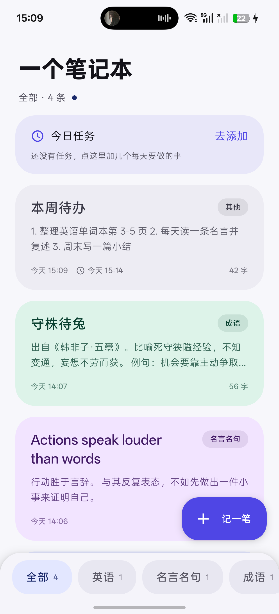
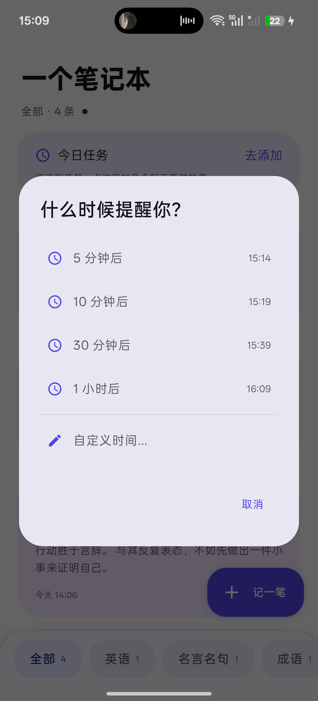
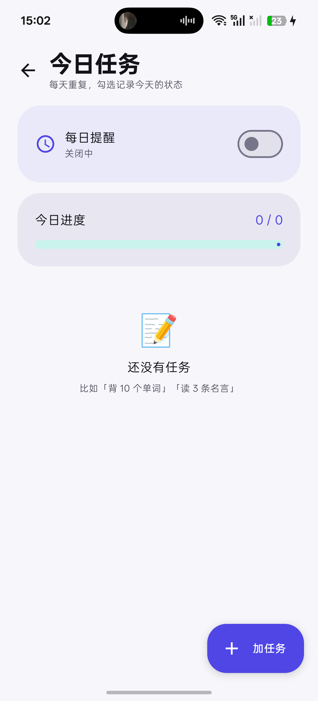

# 一个笔记本

一个本地优先的 Android 笔记 App：多分类笔记 + 系统 TTS 朗读 + 每日任务 + 定时提醒。

全部数据存在手机本地（Room / SQLite），不联网、不用登录。

## 下载

最新版 APK：[Releases](https://github.com/yuctrlv/A-Notebook/releases/latest)

> 支持 Android 8.0（API 26）及以上。如果手机里装过调试版，需要先卸载再装（签名不同）。

## 截图

| 首页 | 提醒 | 今日任务 |
|---|---|---|
|  |  |  |

## 功能

- **笔记**：新建 / 编辑 / 删除 / 重命名；标题可留空（自动用正文前 30 字）
- **分类**：默认「英语 / 名言名句 / 成语 / 其他」，可自己新建、改名、删除；底部胶囊切换
- **朗读**：Android 原生 `TextToSpeech`，支持中文 / 英文、语速、音调；长文本分段朗读并跟踪播放状态
- **定时提醒**：笔记可以设 5 / 10 / 30 分钟、1 小时或自定义时间提醒；到点弹通知，点通知直达该笔记
- **每日任务**：每天固定要做的任务，按日期记录完成状态；可设置每天固定时间提醒今日进度

## 技术栈

| 层 | 用的东西 |
|---|---|
| 语言 / UI | Kotlin 2.2.21 + Jetpack Compose + Material 3 |
| 本地存储 | Room 2.8.1（版本 4，带迁移） |
| 异步 | Coroutines + Flow（`StateFlow` 驱动 UI） |
| 提醒 | WorkManager（一次性任务滚动排期） + Notification |
| 朗读 | `android.speech.tts.TextToSpeech` |
| 架构 | 单 Activity + Navigation Compose，简单 MVVM（ViewModel → Repository → DAO），无 DI 框架 |

## 目录结构

```
app/src/main/java/com/demo/smartnote/
├── MainActivity.kt              # 入口，申请通知权限
├── SmartNoteApplication.kt      # 手动依赖注入（database / repository）
├── data/                        # Room：Entity、DAO、Database、Repository
├── reminder/                    # WorkManager Worker、通知、调度器、DataStore
├── tts/                         # TTS 封装
└── ui/                          # Compose 界面 + ViewModel + 导航
```

## 编译运行

环境要求：

- JDK **21**（Gradle 8.14.6 不支持 JDK 25）
- Android SDK Platform 36、Build-Tools 36
- minSdk 26 / targetSdk 36

1. 用 Android Studio 打开项目根目录
2. 新建 `local.properties`，写入本机 SDK 路径：
   ```properties
   sdk.dir=C:\\Users\\<你的用户名>\\AppData\\Local\\Android\\Sdk
   ```
3. 命令行编译（可选）：
   ```bash
   ./gradlew assembleDebug
   ```
4. 产物：`app/build/outputs/apk/debug/app-debug.apk`

## 已知限制

- 提醒用 WorkManager，精度是「大致到点」，且部分国产系统的省电策略会延迟通知
- 重启手机后，笔记提醒不会自动恢复（每日提醒会）
- 分类目前只能改名/删除，不能排序

## License

MIT
